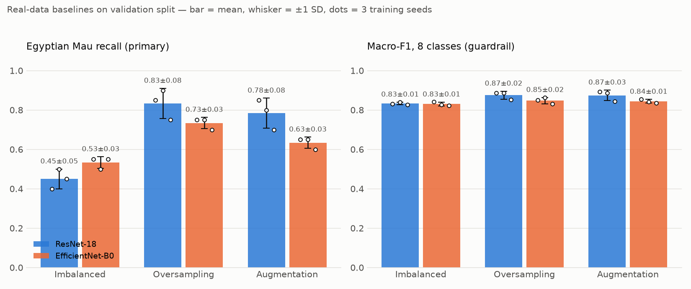

# Assignment 1 — Dataset Protocol and Real-Data Baselines

## Goal
Build a fair experiment **before** generating any synthetic image, answering:

> Can diffusion-generated images improve recognition of an underrepresented class beyond
> oversampling and ordinary augmentation, without harming overall classification quality?

Eight similar cat breeds from Oxford-IIIT Pet are used; **Egyptian Mau is the minority class**.

## What was done

### 1. Data and environment
- Downloaded Oxford-IIIT Pet via `torchvision.datasets.OxfordIIITPet` into `data/oxford-iiit-pet/`
  (200 images per cat breed).
- Pretrained backbones come from the **Hugging Face Hub** via `timm`
  (`timm/resnet18.tv_in1k`, `timm/efficientnet_b0.ra_in1k`).
- Training runs on an NVIDIA RTX 4060 Laptop GPU (PyTorch 2.14.1 + CUDA 13.0).

### 2. One-time split with a manifest — `scripts/make_split.py`
- Unreadable files dropped (none found).
- **Near-duplicates removed before splitting**: perceptual hash (pHash) of each image and of
  its mirror; Hamming distance ≤ 6 counts as a copy. 41 images dropped (24 of them Bombay,
  where dark, low-texture photos also give some false matches — dropping is conservative).
- Split with seed 42, saved to `data/manifest.csv`, which lists **every** image of the 8 breeds
  (1600 rows) with its role: `train` / `val` / `test` (905 used images), `unused`, or
  `dropped_duplicate`; class-count table in `data/class_counts.csv`.

| Breed | train | val | test |
|---|---|---|---|
| Abyssinian | 70 | 20 | 30 |
| Bengal | 70 | 20 | 30 |
| Birman | 70 | 20 | 30 |
| Bombay | 70 | 20 | 30 |
| **Egyptian Mau** | **15** | 20 | 30 |
| Ragdoll | 70 | 20 | 30 |
| Russian Blue | 70 | 20 | 30 |
| Siamese | 70 | 20 | 30 |

Imbalance exists only in training; validation and test are balanced. **The test split is locked**
and has not been used for anything.

### 3. Automated leakage check — `scripts/check_leakage.py`
Fails (exit code 1) if any image ID is in more than one split, if any cross-split pair is a
near-duplicate (pHash ≤ 6, including mirrored copies), or if val/test are not class-balanced.
Result: **PASSED** — 905 unique images, no exact or near-duplicate overlap.

### 4. Added-data budget
**55 observations** (= 70 − 15) for every condition that adds data. The extra rows cycle through
the 15 Mau images evenly (3 full passes + 10). The same budget will be used for synthetic images.

### 5. Three baselines — `scripts/train_baseline.py`
| Condition | What changes |
|---|---|
| Imbalanced real | nothing |
| Oversampling | +55 repeated Mau rows (standard train transform) |
| Augmentation | +55 Mau rows with stronger transforms (crop 0.6–1, flip, colour jitter, ±15° rotation) |

Everything else is fixed: frozen ImageNet backbone (kept in eval mode so BatchNorm statistics
do not drift), linear head, Adam lr 1e-3, batch 32, **10 epochs, last epoch reported** (no epoch
selection on validation), 3 training seeds (0, 1, 2). Two backbones check whether conclusions
transfer across architectures.

Fixes made to the initial code along the way: weights moved to Hugging Face; BatchNorm stats
were being updated despite the "frozen" backbone; best-epoch selection on the primary metric
(optimistic bias) replaced by a fixed schedule; single seed replaced by 3 seeds; leakage check
extended from exact IDs to near-duplicates.

## Results (validation split, mean ± SD over 3 seeds)

| Model | Condition | Mau recall (primary) | Macro-F1 (guardrail) |
|---|---|---|---|
| ResNet-18 | Imbalanced | 0.450 ± 0.050 | 0.833 ± 0.006 |
| ResNet-18 | Oversampling | **0.833 ± 0.076** | 0.875 ± 0.020 |
| ResNet-18 | Augmentation | 0.783 ± 0.076 | 0.875 ± 0.026 |
| EfficientNet-B0 | Imbalanced | 0.533 ± 0.029 | 0.830 ± 0.010 |
| EfficientNet-B0 | Oversampling | **0.733 ± 0.029** | 0.847 ± 0.016 |
| EfficientNet-B0 | Augmentation | 0.633 ± 0.029 | 0.844 ± 0.010 |

### Observations
- The imbalance clearly hurts the minority: with only 15 training images, Mau recall is
  0.45–0.53, far below the other classes.
- Both rebalancing strategies raise Mau recall a lot (+0.2 to +0.4) **without hurting Macro-F1**,
  which actually increases slightly.
- **Oversampling is the strongest real-data baseline** for both backbones; stronger augmentation
  does not beat plain repetition here. This is the bar the synthetic data must clear.
- The ranking (oversampling > augmentation > imbalanced) holds for both architectures.
- Caveat: with 20 Mau validation images, recall moves in steps of 0.05 and the SDs come from only
  3 seeds, so differences below ~0.05–0.1 should not be over-interpreted.

## Files
| File | Purpose |
|---|---|
| `protocol.md` | Frozen protocol: split, budget, metrics, seeds, leakage policy |
| `data/manifest.csv`, `data/class_counts.csv` | Reproducible split and class-count table |
| `scripts/make_split.py`, `scripts/hashing.py` | Cleaning, dedup and split |
| `scripts/check_leakage.py` | Automated overlap/leakage check |
| `scripts/train_baseline.py`, `scripts/dataset.py` | Baseline training |
| `scripts/summarize_results.py`, `scripts/plot_results.py` | Results table and figure |
| `results/*_metrics.json`, `results/baselines.md`, `results/baselines.png` | Results |

## Next steps
Generate 55 Egyptian Mau images with a diffusion model (from Hugging Face), add them under
the same budget and training procedure, and compare against the oversampling baseline on
validation. The test split stays locked until Meeting 5.
